<p align="center">
  
</p>

<p align="center">
  <a href="https://ppw-crud-productos-firebase.vercel.app"><b>Abrir la aplicación</b></a>
  &nbsp;·&nbsp;
  <a href="https://github.com/DannielS110/ppw-crud-productos-firebase"><b>Ver el código</b></a>
</p>

---

## Sobre el proyecto

**Gestión de Productos** es una aplicación web para administrar un pequeño inventario. Desde una sola pantalla se pueden registrar productos, verlos en una tabla, corregir sus datos y eliminarlos. Toda la información se guarda en **Cloud Firestore**, así que los cambios no se pierden al recargar la página ni al abrirla desde otro equipo.

La hice para la **Práctica 02.2** de Programación y Plataformas Web, partiendo del proyecto Angular que trabajamos en clase y completando el CRUD de la colección `productos`.

<p align="center">
  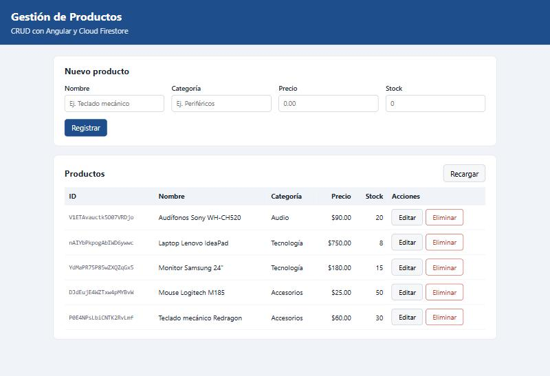
  <br>
  <sub>Pantalla principal: formulario arriba y la tabla con los productos guardados en Firestore.</sub>
</p>

## Qué se puede hacer

| Operación | En la interfaz | En `ProductoService` |
|---|---|---|
| **Crear** | Llenar el formulario y pulsar **Registrar** | `crear(producto)` con `addDoc` |
| **Consultar** | La tabla se carga sola al abrir la página; también está el botón **Recargar** | `listar()` con `getDocs` |
| **Actualizar** | Pulsar **Editar** en una fila, cambiar los datos y pulsar **Guardar cambios** | `actualizar(id, producto)` con `updateDoc` |
| **Eliminar** | Pulsar **Eliminar** y confirmar. Si se cancela, el producto se queda | `eliminar(id)` con `deleteDoc` |

Después de cada operación la tabla se vuelve a cargar desde Firestore, y arriba aparece un mensaje que dice si todo salió bien o qué falló. Cuando la colección está vacía, la tabla lo indica en lugar de quedarse en blanco.

### Reglas del formulario

- **Nombre** y **categoría** son obligatorios y deben tener texto real. Un campo con solo espacios no pasa.
- **Precio** tiene que ser un número mayor o igual a 0.
- **Stock** tiene que ser un número entero mayor o igual a 0, sin decimales.

Mientras algún campo esté mal, el botón no envía nada y se muestra el mensaje debajo del campo correspondiente.

## Modelo de producto

Cada documento de la colección `productos` tiene cuatro campos. El `id` no se guarda como campo: es el identificador que Firestore le asigna al documento, y lo uso para editarlo y eliminarlo.

```ts
export interface Producto {
  id?: string;       // id del documento en Firestore
  nombre: string;
  precio: number;
  stock: number;
  categoria: string;
}
```

## Cómo está organizado

```
src/app/
├── firebase.config.ts            → inicializa Firebase y la instancia de Firestore
├── models/producto.ts            → interfaz Producto
├── services/producto.service.ts  → las cuatro operaciones contra Firestore
└── productos/                    → componente con el formulario y la tabla
scripts/set-env.mjs               → genera la configuración de Firebase desde variables de entorno
firestore.rules                   → reglas de seguridad de la colección
```

El componente nunca habla directamente con Firestore: todo pasa por `ProductoService`. Así, la interfaz solo se encarga de mostrar datos y validar el formulario, y si mañana cambia la base de datos, el cambio se hace en un solo archivo.

## Pruebas realizadas

Todas las pruebas las hice sobre la versión publicada en Vercel, recargando la página después de cada escritura para comprobar que Firestore realmente guardó el cambio.

### 1. Datos inválidos

Probé con un nombre formado solo por espacios, un precio de `-15` y un stock de `3.7`. El formulario no dejó registrar y mostró un mensaje en cada campo.

<p align="center">
  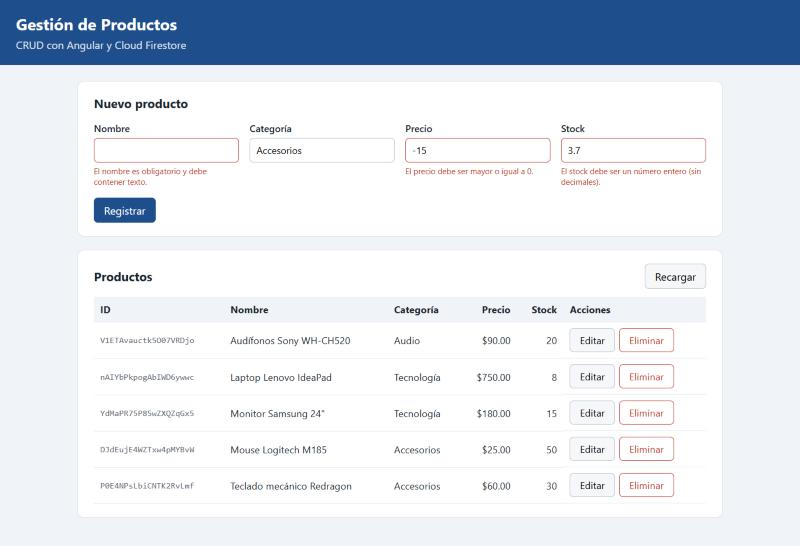
</p>

### 2. Crear un producto

Registré un **Parlante JBL Go 3** de la categoría Audio, a $45.99 y con 10 unidades. Apareció en la tabla con su id de Firestore y, al recargar, seguía ahí.

<table>
  <tr>
    <td width="50%">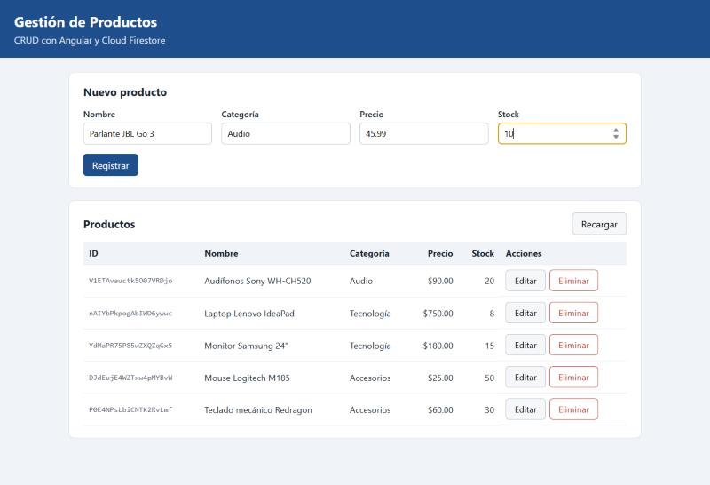</td>
    <td width="50%">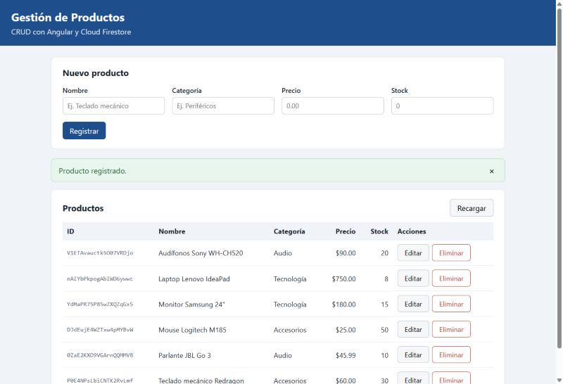</td>
  </tr>
  <tr>
    <td align="center"><sub>Formulario con los datos del producto</sub></td>
    <td align="center"><sub>Mensaje de confirmación y el producto en la tabla</sub></td>
  </tr>
</table>

<p align="center">
  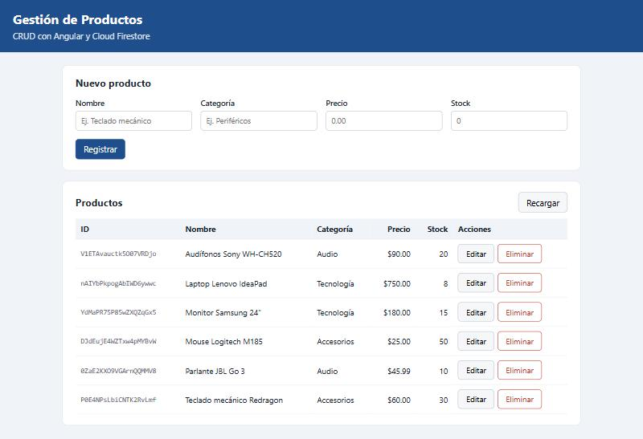
  <br>
  <sub>Después de recargar (F5) el producto sigue en la lista.</sub>
</p>

### 3. Editar un producto

Al pulsar **Editar**, los datos del parlante se cargaron en el formulario y la fila quedó resaltada. Cambié el precio a $39.99 y el stock a 25. Al guardar, la tabla mostró los valores nuevos con **el mismo id**, es decir, se actualizó el documento existente en lugar de crear otro.

<table>
  <tr>
    <td width="50%">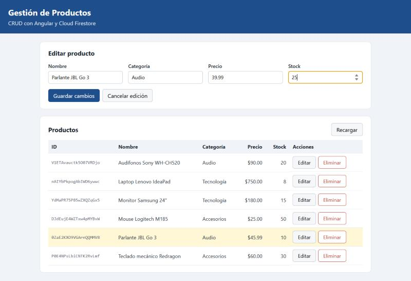</td>
    <td width="50%"></td>
  </tr>
  <tr>
    <td align="center"><sub>Modo edición con la fila seleccionada</sub></td>
    <td align="center"><sub>Cambios guardados con el mismo id</sub></td>
  </tr>
</table>

En la consola de Firebase se ve el mismo documento con los valores actualizados:

<p align="center">
  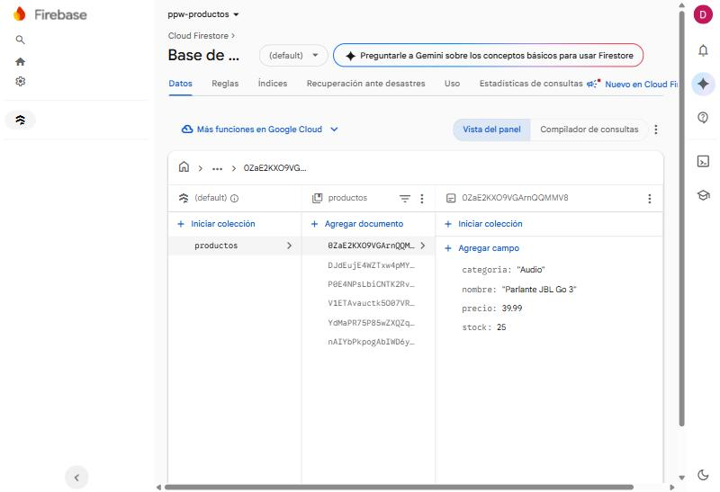
</p>

### 4. Eliminar un producto

Al pulsar **Eliminar**, el navegador pide confirmación. Primero cancelé, y el producto se quedó en la tabla con un aviso. Después lo intenté de nuevo y acepté: el parlante desapareció y, tras recargar, la colección volvió a sus productos originales.

<table>
  <tr>
    <td width="50%">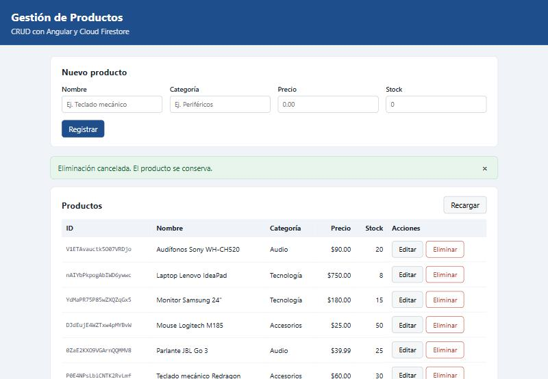</td>
    <td width="50%">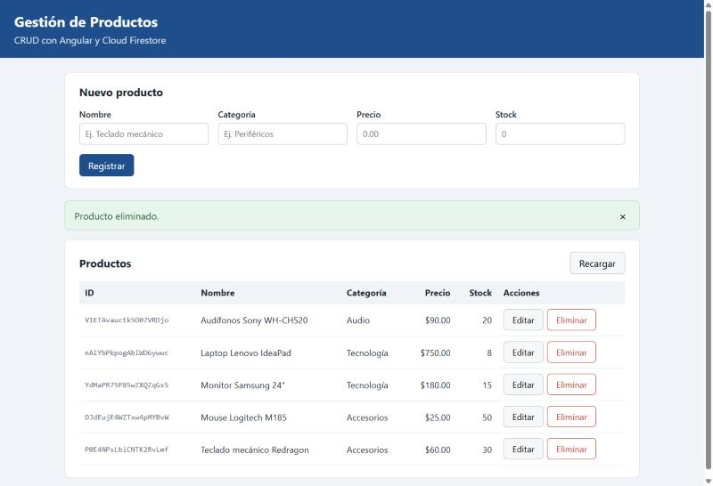</td>
  </tr>
  <tr>
    <td align="center"><sub>Al cancelar, el producto se conserva</sub></td>
    <td align="center"><sub>Al confirmar, el producto se elimina</sub></td>
  </tr>
</table>

### 5. Pruebas unitarias

Además de las pruebas manuales, el componente tiene pruebas automáticas que revisan el mensaje de colección vacía, el ciclo completo de crear, editar y eliminar, y el rechazo de datos inválidos.

<p align="center">
  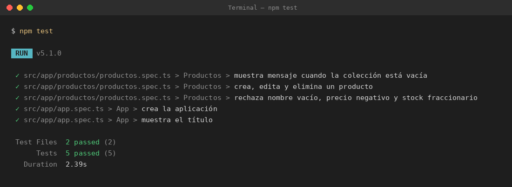
</p>

## Configurar Firebase

1. Entrar a la [consola de Firebase](https://console.firebase.google.com) y crear un proyecto.
2. En **Firestore Database**, crear la base de datos.
3. En la pestaña **Reglas**, pegar el contenido de [`firestore.rules`](firestore.rules) y publicar. Estas reglas solo permiten trabajar con la colección `productos` y vuelven a validar en el servidor que los datos tengan el formato correcto.
4. En **Configuración del proyecto → Tus apps**, registrar una app web (`</>`) y copiar los valores de `firebaseConfig`.

### ¿Dónde quedan las credenciales?

No están en el repositorio. El script `scripts/set-env.mjs` se ejecuta antes de `npm start` y de `npm run build`, lee las variables `FIREBASE_*` y genera `src/environments/environment.ts`. Ese archivo, igual que `.env`, está en el `.gitignore`.

- **En local:** las variables salen del archivo `.env`.
- **En Vercel:** salen de *Settings → Environment Variables*.

## Ejecutarlo en local

Se necesita Node.js 20 o superior.

```bash
git clone https://github.com/DannielS110/ppw-crud-productos-firebase.git
cd ppw-crud-productos-firebase
npm install
```

Crear un archivo `.env` en la raíz del proyecto, tomando como base `.env.example`, y completarlo con los datos de `firebaseConfig`:

```
FIREBASE_API_KEY=...
FIREBASE_AUTH_DOMAIN=...
FIREBASE_PROJECT_ID=...
FIREBASE_STORAGE_BUCKET=...
FIREBASE_MESSAGING_SENDER_ID=...
FIREBASE_APP_ID=...
```

Y luego:

```bash
npm start        # abre en http://localhost:4200
npm test         # corre las pruebas unitarias
npm run build    # compilación de producción
```

## Despliegue en Vercel

1. En [vercel.com/new](https://vercel.com/new), importar este repositorio de GitHub.
2. Vercel reconoce el proyecto como Angular. El archivo `vercel.json` ya indica el comando de compilación y la carpeta de salida (`dist/my-angular-app/browser`).
3. Agregar las seis variables `FIREBASE_*` en **Environment Variables**.
4. Pulsar **Deploy**. Cada `git push` a `main` vuelve a desplegar la aplicación automáticamente.

<table>
  <tr>
    <td width="50%">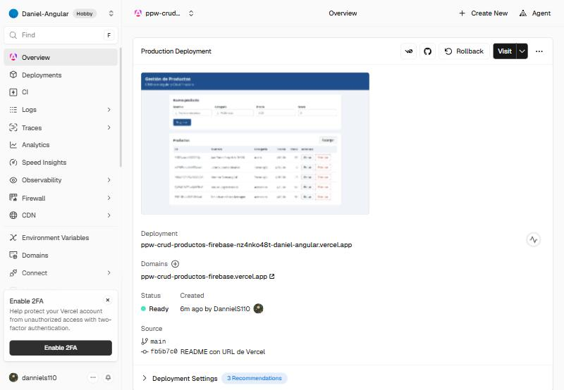</td>
    <td width="50%">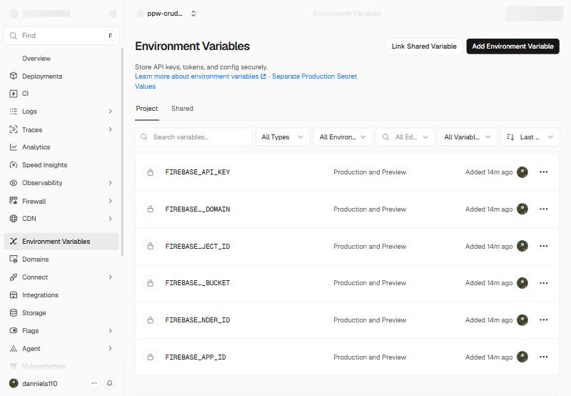</td>
  </tr>
  <tr>
    <td align="center"><sub>Despliegue en producción con estado <b>Ready</b></sub></td>
    <td align="center"><sub>Variables de Firebase configuradas en Vercel</sub></td>
  </tr>
</table>

**URL pública:** https://ppw-crud-productos-firebase.vercel.app

---

<p align="center">
  <sub>
    Programación y Plataformas Web · Universidad Politécnica Salesiana, Sede Cuenca<br>
    Docente: Ing. Gabriel A. León Paredes, PhD · Autor: Daniel
  </sub>
</p>
